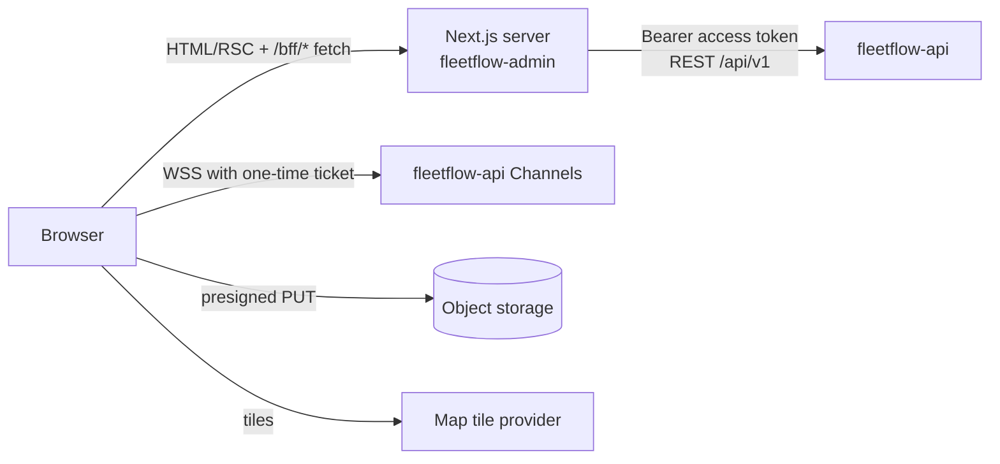

# fleetflow-admin: Architecture

Status legend: **APPROVED** · **PROPOSED** · **NEEDS APPROVAL** · **FUTURE**. Research date: **2026-11-21**. Versions in §2 and §24.1 were re-verified and installed at Phase 0 (2026-11-23); `package.json` pins the exact versions.

## Table of contents
1. [Purpose & boundaries](#1-purpose--boundaries)
2. [Technology](#2-technology)
3. [System context](#3-system-context)
4. [App structure](#4-app-structure)
5. [Routing & layouts](#5-routing--layouts)
6. [Feature modules](#6-feature-modules)
7. [Shared components](#7-shared-components)
8. [API client & BFF](#8-api-client--bff)
9. [Authentication](#9-authentication)
10. [Authorization & permission guards](#10-authorization--permission-guards)
11. [Server state](#11-server-state)
12. [Local & URL state](#12-local--url-state)
13. [Forms & validation](#13-forms--validation)
14. [Tables, filters, search, pagination](#14-tables-filters-search-pagination)
15. [Dashboard & charts](#15-dashboard--charts)
16. [Maps](#16-maps)
17. [Real-time](#17-real-time)
18. [Feedback states](#18-feedback-states)
19. [Dialogs, toasts, uploads, export](#19-dialogs-toasts-uploads-export)
20. [Responsive & accessibility](#20-responsive--accessibility)
21. [Performance](#21-performance)
22. [Security](#22-security)
23. [Logging, monitoring, environments](#23-logging-monitoring-environments)
24. [Testing architecture](#24-testing-architecture)
25. [Module roadmap](#25-module-roadmap)

---

## 1. Purpose & boundaries
fleetflow-admin is the web console for office and warehouse staff. It renders data and sends commands to fleetflow-api. **Every business rule and permission is enforced by the API.** The admin mirrors rules only for better UX (early validation, hidden actions) and must handle the API rejecting anything.

## 2. Technology
| Concern | Choice | Version (2026-11-21) | Status | Why / alternatives |
|---|---|---|---|---|
| Framework | Next.js (App Router) | 16.4.6 | APPROVED (D-ADM-1) | Layouts, route handlers for the BFF, `proxy.ts` (renamed from `middleware.ts` in v16). Alt: Vite SPA (no BFF, so tokens end up in the browser) |
| UI runtime | React | 19.3.1 | APPROVED (D-ADM-1) | Next 16 peer requirement |
| Language | TypeScript, `strict` + `noUncheckedIndexedAccess` | 6.0.3 | APPROVED (D-ADM-7) | Last JS-based compiler; works with Next 16.4 and typescript-eslint. Revisit TS 7 (native) when the tooling supports it |
| Styling | Tailwind CSS v4 (`@tailwindcss/turbopack`) | 4.3.5 | APPROVED (D-ADM-1) | Tokens as CSS variables (`@theme`), see design.md |
| Components | shadcn/ui (copy-in source, Radix primitives, `cn` class merging) | CLI 4.23.0 / radix-ui 1.8.1 | APPROVED (D-ADM-1) | We own the code, so it can follow design.md exactly; accessible primitives. Alt: MUI/Mantine (heavier, harder to de-genericize) |
| Icons | lucide-react | 1.78.0 | APPROVED (D-ADM-1) | One icon set only |
| Server state | TanStack Query | 5.108.4 | APPROVED (D-ADM-1), installed Phase 1 | Caching, invalidation from WS events, optimistic updates with rollback |
| Tables | TanStack Table (headless) + TanStack Virtual | 9.3.1 / 3.14.26 | PROPOSED, not installed yet (D-ADM-20) | v9 stable since 9.3 (Oct 2026). `DataTable` renders columns itself until a list needs sorting, column visibility, selection or virtualization. Alt: AG Grid (license, weight) |
| Forms | React Hook Form + Zod 4 + @hookform/resolvers | 7.92.0 / 4.6.7 / 7.0.8 | PROPOSED | |
| URL state | nuqs | 2.10.3 | PROPOSED, not installed yet (the users list has only cursor and page size, read with `useSearchParams`) | Typed search-param state for filters. Alt: hand-rolled `useSearchParams` |
| Charts | Recharts | 3.11.0 | PROPOSED | Enough for ops KPIs. Alt: ECharts if we need very large series |
| Maps | MapLibre GL via `react-map-gl/maplibre` | 6.19.0 / 8.1.3 | PROPOSED | Open source, no per-load license. **Tile provider NEEDS APPROVAL** (MapTiler/Stadia: paid tiers; or self-hosted). Alt: Google Maps JS (cost, ToS) |
| Toasts | sonner | 2.0.8 | PROPOSED | The shadcn default |
| Dates | date-fns 4 + `Intl` | 4.4.0 | PROPOSED | Company timezone display via `Intl.DateTimeFormat` |
| API types | openapi-typescript + openapi-fetch | 7.13.0 / 0.17.0 | APPROVED (D-ADM-3) | Types generated from a pinned copy of fleetflow-api's schema (`openapi/fleetflow-api.yaml`). openapi-typescript 7.13 has a peer dependency on TS 5, so `npm run api:types` runs it via `npx` with TS 5.9.3 and never installs it into the app. openapi-fetch is added in Phase 1. Alt: orval (8.48.0) generating TanStack Query hooks (more generated code) |
| Realtime | Native `WebSocket` + small reconnect helper | — | PROPOSED | No socket library needed |
| Monitoring | Sentry (`@sentry/nextjs`) | 11.16.0 | NEEDS APPROVAL | Vendor account |
| Testing | Vitest, RTL, user-event, MSW, Playwright, axe | see §24 | PROPOSED | |

No overlapping libraries: one component system, one icon set, one chart library, one toast system, one date library, one state library (TanStack Query; no Redux or Zustand unless a measured need appears).

## 3. System context


## 4. App structure
```text
fleetflow-admin/
├── src/
│   ├── app/
│   │   ├── (auth)/login, forgot-password, reset-password
│   │   ├── (console)/layout.tsx           # sidebar + header shell, session gate
│   │   │   ├── dashboard/
│   │   │   ├── shipments/ [id]/ import/
│   │   │   ├── dispatch/                  # dispatch board
│   │   │   ├── routes/ [id]/
│   │   │   ├── drivers/ vehicles/ maintenance/ fuel/
│   │   │   ├── warehouse/ receiving/ sorting/ loading/
│   │   │   ├── customers/ exceptions/ pod/ notifications/ reports/
│   │   │   └── settings/ users/ roles/ company/ warehouses/ zones/ service-types/ integrations/ audit-logs/
│   │   ├── track/[token]/                 # public customer tracking page (no console shell)
│   │   └── bff/[...path]/route.ts         # authenticated proxy to fleetflow-api
│   ├── features/<module>/                 # api.ts (queries/mutations), components/, schemas.ts, columns.tsx
│   ├── components/ui/                     # shadcn primitives (design.md compliant)
│   ├── components/shared/                 # DataTable, PageHeader, StatusBadge, EmptyState, ErrorState, PermissionGate...
│   ├── lib/                               # api client, auth/session, realtime, formatters, permissions
│   ├── styles/tokens.css                  # design tokens (design.md)
│   └── generated/api.d.ts                 # from fleetflow-api OpenAPI (never edited by hand)
├── tests/e2e/                             # Playwright
└── proxy.ts                               # route-level session redirect (UX only)
```
Rule: a feature imports from `components/*` and `lib/*`, never from another feature's internals. Cross-feature reuse gets promoted to `components/shared`, but only once two features actually need it.

## 5. Routing & layouts
- Route groups: `(auth)` (minimal centered layout), `(console)` (shell: sidebar, header, breadcrumbs), `track/[token]` (public, branded, no auth).
- `proxy.ts` redirects requests without a session cookie to `/login?next=…`. This is UX only; the API enforces auth.
- Detail pages use nested routes (`/shipments/[id]`). Quick views use a drawer driven by a URL param (`?view=FF-…`) so the list keeps its context and links can be shared.
- Navigation is defined once (`lib/navigation.ts`) with a required permission per item. The sidebar renders only the permitted items.

## 6. Feature modules
Each module in `features/<name>/`:
- `api.ts`: TanStack Query `queryOptions` factories and mutations wrapping the typed client; query keys `[module, 'list', filters]` / `[module, 'detail', id]`.
- `schemas.ts`: Zod schemas for forms, mirroring API validation (the API remains authoritative).
- `components/`: module-specific UI built from shared components.
Long-term modules are listed in §25. Phases decide the build order.

## 7. Shared components
Built once in Phase 1, per design.md: `AppShell`, `Sidebar`, `Header`, `PageHeader`, `DataTable` (sorting, filters, pagination, column visibility, row selection, bulk actions, virtualization), `FilterBar`, `StatusBadge` (all logistics enums), `EmptyState`, `ErrorState`, `Skeletons`, `ConfirmDialog`, `FormField` wrappers, `FileDropzone`, `Timeline`, `MapPanel`, `KpiStat`, `PermissionGate`, `RelativeTime`, `GpsFreshness`. A new shared component requires the design.md procedure (§Consistency).

## 8. API client & BFF
- **BFF (APPROVED, D-ADM-2)**: the browser calls `/bff/api/v1/...` on the Next server (the path mirrors the generated contract paths, D-ADM-21). Token endpoints (`auth/*`) are refused there, path segments are restricted to `[A-Za-z0-9_-]`, only `Idempotency-Key` is forwarded from the browser, and mutations need a same-origin JSON request. The catch-all route handler reads the httpOnly access cookie, forwards to `FLEETFLOW_API_URL/api/v1/...` with `Authorization: Bearer`, and streams the response back. On 401 `auth.token_expired`, it refreshes once using the refresh cookie (single-flight per session), retries, and re-sets the cookies. If the refresh fails, it clears the cookies and returns 401, and the client redirects to login.
- Typed client: `openapi-fetch` (`lib/api/client.ts`) with base `/bff` and types from `generated/api.d.ts`; `unwrap()` turns error responses into `ApiError` and network failures into `NetworkError`. A 401 that reaches TanStack Query (refresh already failed in the BFF) sends the user to login with `next`.
- Every mutation sends an `Idempotency-Key` (UUID per user action, reused on retry).
- Errors: the client parses the API error envelope (`code`, `detail`, `errors`) into an `ApiError`. Forms map `errors` to fields. Everything else goes to a toast or error state by `code`.
- Server Components may call the API directly server-side for the initial shell data (session user, permissions). Interactive lists use TanStack Query on the client.

## 9. Authentication
- Login form → `POST /bff/auth/login` → Next server calls the API → sets `ff_access` (15 min) and `ff_refresh` (30 d) cookies: `httpOnly; Secure; SameSite=Lax; Path=/`. Tokens are never exposed to JavaScript.
- Session bootstrap: `(console)/layout.tsx` fetches `/me` (user, company, branches, permissions) server-side, behind `<Suspense>` because Cache Components treats the cookie read as request-time data. A 401 redirects to login; other failures go to the error boundary.
- Refresh for page navigations happens in `proxy.ts`, because Server Components cannot set cookies. It rotates the tokens, writes the new access token into the current request and the response, and shares one in-flight refresh per token with the BFF route handlers (D-ADM-12). Cookie lifetimes follow each token's `exp` claim.
- Logout → the BFF ends the session at the API (`POST /auth/logout/` with the refresh token) and always clears the cookies, even if the API is unreachable.
- The BFF forwards the browser's IP in `X-Forwarded-For` so fleetflow-api throttles per user (see memory.md API requests).
- CSRF: SameSite=Lax plus BFF mutation routes requiring `Content-Type: application/json` and an `Origin` check.
- Depends on the API decision **D-API-2** (`../fleetflow-api/memory.md`).

## 10. Authorization & permission guards
- `usePermissions()` reads permission codenames from `/me`. `<PermissionGate perm="dispatch.assign_driver">` hides or disables UI. Page-level guards render a 403 state for direct URL access.
- **Hiding is not security.** Every action must still handle API 403/404 gracefully (toast plus refetch).
- Branch filter: users with multiple branches get a branch switcher in the header. The selected branch is sent as a filter, and the API still validates membership.

## 11. Server state
- TanStack Query defaults: `staleTime` 30 s for lists, 10 s for the dispatch board and live views; `retry` 2 for GET (none on 4xx); `refetchOnWindowFocus` true for operational views.
- Mutations: optimistic updates only where rollback is simple (stop reordering, assignment), always with `onError` rollback and `onSettled` invalidate. Status transitions are **not** optimistic: show pending, then the confirmed server state.
- WS events invalidate the matching query keys (§17).

## 12. Local & URL state
- URL (nuqs) for anything shareable or worth preserving: filters, sort, page or cursor, search, selected tab, open drawer ID. Back/forward restores the view.
- React state or `useReducer` for ephemeral UI (dialogs, drag state on the dispatch board).
- `localStorage` (try/catch) for per-user preferences only: sidebar collapsed, table density, column visibility.
- No global client store in MVP.

## 13. Forms & validation
- RHF + Zod. Shows validation messages on blur and on submit, with the error summary focused on submit.
- Cross-field validation in Zod `superRefine` (e.g. scheduled date vs service type cutoff).
- Submit button shows a pending state and is disabled while pending (prevents duplicate submits). The idempotency key protects against retries.
- API validation errors map to fields. Unknown fields go to a form-level alert.
- Dirty-form navigation guard: confirm before leaving with unsaved changes (`beforeunload` plus router interception).
- Native inputs where adequate (`type="date"`, `datetime-local` styled per design.md). A date-range picker component is only added if native proves insufficient (NEEDS APPROVAL then).

## 14. Tables, filters, search, pagination
- `DataTable` wraps TanStack Table with **server-side** sorting, filtering and pagination (the API handles it; the client never loads full datasets).
- Cursor pagination with "Load more" or next/prev for operational lists. Numbered pages only where the API offers limit/offset (audit logs, reports).
- Search: debounced 300 ms, minimum 2 characters, searching tracking number, reference, customer and phone. The query is in the URL.
- Column visibility and density are persisted per table in localStorage.
- Row actions sit in a visible "⋯" menu button (not hover-only). Bulk actions appear in a sticky selection bar once rows are selected.
- Large lists (>200 rows rendered) use row virtualization.

## 15. Dashboard & charts
- Dashboard = a dense operational overview: today's shipment counts by status, on-time %, active routes, drivers live/stale/offline, open exceptions, and alerts. Data comes from fleetflow-api reporting endpoints (API Phase 10). Before that, the dashboard shows only the counts available from list endpoints.
- KPI definitions come from the API (e.g. delivery-rate denominator). The admin never computes KPIs from paged data.
- Recharts: line or area for trends, stacked bar for status mix, no pie charts beyond 4 slices. Every chart has a table or accessible summary alternative.

## 16. Maps
- `MapPanel` (MapLibre) shows driver markers (last-known location, coloured by freshness), route polylines and stop pins.
- More than 500 markers → clustering (MapLibre GeoJSON source clustering).
- Missing or invalid coordinates: the entity is listed in a side panel as "No location" and is never plotted at 0,0.
- Tile provider failure: show an error state over the map area; the lists keep working.
- Location privacy: only users with `tracking.view` see driver locations, and the API filters by branch.

## 17. Real-time
- Connect: `POST /bff/realtime/ticket` → one-time ticket → `wss://…/ws/?ticket=…`.
- Reconnect with exponential backoff (1 s → 30 s max, with jitter). On reconnect, invalidate all live queries (events aren't replayed).
- Event handler map: `shipment.status_changed` → invalidate `['shipments', …]`, `['dispatch']`; `driver.location_updated` → update the map cache directly (high frequency, throttled to 1 render/s); `exception.created` → toast plus invalidate.
- Connection state is shown in the header (`Live` / `Reconnecting…` / `Offline – polling`). If WS stays down for more than 60 s, fall back to polling every 30 s.
- Event names come from the API registry (`../fleetflow-api/architecture.md` §17, §25).

## 18. Feedback states
Every data view implements all four: **loading** (skeleton matching the layout, never a lone spinner for tables), **empty** (explains why and what to do, with a primary action when permitted), **error** (message from the error code, a retry button, `request_id` shown for support), and **success**. Mutations always give feedback (toast or inline). See design.md §States.

## 19. Dialogs, toasts, uploads, export
- Destructive actions (cancel shipment, delete draft, remove assignment, deactivate user) → `ConfirmDialog` naming the object. High-impact bulk actions require typing the count or reference.
- Toasts: success 4 s, error persistent until dismissed, at most 3 visible.
- Uploads (bulk import CSV/XLSX, documents): `FileDropzone` checks type and size client-side, then presign → PUT with progress → confirm via the API (`../fleetflow-api/architecture.md` §19). Interruption shows a retry; the import then shows the row-level validation report from the API.
- Export: requests an async export from the API → notification and download link when ready. No client-side CSV generation of partial data.

## 20. Responsive & accessibility
- Primary target: desktop 1280–1920 px. Tablet (≥ 768) is supported for warehouse and supervisors. Phone (< 768) gets read-mostly views (shipment lookup, tracking, exceptions); the dispatch board shows a "use a larger screen" state with a list fallback.
- WCAG 2.2 AA: keyboard reachable everything, visible focus ring (token), labels on all inputs, status never shown by colour alone (icon plus text), `aria-live` for toasts and realtime updates (polite), reduced motion respected.

## 21. Performance
- Route-level code splitting (default). The map and charts are lazy-loaded (`next/dynamic`, `ssr:false` for MapLibre).
- Budgets (PROPOSED): initial JS for the console shell ≤ 200 KB gzip; LCP < 2.5 s on the dashboard over broadband; table interaction < 100 ms with 1,000 rendered rows (virtualized).
- Avoid waterfalls: prefetch the detail query on row hover/focus.

## 22. Security
- Tokens only in httpOnly cookies (no localStorage tokens). Strict CSP with nonces (Next supports this), `frame-ancestors 'none'`, HSTS, `Referrer-Policy: strict-origin-when-cross-origin`.
- Never render API HTML; React escaping only. No `dangerouslySetInnerHTML`.
- The BFF forwards only to the configured API origin (no open proxy), passes through only allow-listed headers, and strips the `Cookie` header before forwarding.
- Presigned upload and download URLs are never logged. POD images are fetched via short-lived URLs from the API.
- Exports are permission-gated by the API, and the UI hides them without the permission.
- Public tracking page: only the fields the API's public endpoint returns; `noindex`.

## 23. Logging, monitoring, environments
- Env vars: `FLEETFLOW_API_URL` (server only), `NEXT_PUBLIC_WS_URL`, `NEXT_PUBLIC_MAP_STYLE_URL`, `SENTRY_DSN` (if approved), and `NEXT_PUBLIC_APP_ENV`. A `.env.example` documents each one. Nothing secret gets a `NEXT_PUBLIC_` prefix.
- Client errors go to Sentry (if approved) with the `request_id` correlation. No PII in breadcrumbs (mask addresses and phones).
- Environments: local (against local fleetflow-api via Docker), staging, production. Hosting NEEDS APPROVAL (Vercel or container).

## 24. Testing architecture

### 24.1 Stack (PROPOSED)
| Tool | Version | Use |
|---|---|---|
| Vitest | 5.1.1 | unit and component runner (jsdom) |
| React Testing Library + user-event | 16.3.3 / 14.6.13 | component behavior via roles and labels |
| MSW | 3.0.7 (added in Phase 1 with the first API call) | API mocking at the network layer for component and integration tests, with handlers typed from the OpenAPI types |
| Playwright | 1.65.1 | E2E; Chromium from Phase 0, Firefox and WebKit added in Phase 12 |
| @axe-core/playwright | 4.14.0 | a11y assertions in E2E for each page |
| Visual regression | — | **Not in MVP.** Revisit for the dispatch board and design system pages in Phase 12 if regressions appear (Playwright `toHaveScreenshot`) |

E2E environments: (a) **mocked**: Playwright against the Next app with MSW, fast, runs on every PR; (b) **full stack**: Playwright against fleetflow-api in Docker with seeded data, runs nightly and before release (cross-repo, needs the API compose file).

Coverage (PROPOSED): `lib/` (api client, auth, permissions, realtime, formatters) ≥ 90 %; feature form schemas and mutations ≥ 85 %; UI components are covered by behavior tests, not a percentage. Merge gate: typecheck, lint, Vitest, mocked Playwright smoke suite, axe with no serious or critical violations.

### 24.2 Components
| Case | Expected |
|---|---|
| Renders with valid props | correct text, roles, labels |
| Optional props missing | sensible defaults, no crash |
| Invalid or unknown enum (e.g. status not in map) | neutral "Unknown" badge plus console warning, no crash |
| Empty data | EmptyState with message and action (if permitted) |
| Loading | skeleton matching layout; `aria-busy` |
| Error | ErrorState with retry calling refetch |
| Keyboard | Tab order logical, Enter/Space activate, Esc closes overlays, focus returns to trigger |
| Narrow viewport (768 px) | no horizontal page scroll; table scrolls within its container |

### 24.3 Forms (shipment create as reference)
| Case | Expected |
|---|---|
| Required fields empty → submit | field errors, focus on first invalid, no request |
| Invalid phone, postal code, email | inline message from schema |
| Weight 0, negative, > max; boundary at max | errors at invalid values, max accepted |
| Cross-field (delivery date before pickup) | error on the dependent field |
| Submit pending | button disabled plus spinner; double-click sends 1 request |
| API 400 with field errors | mapped to fields; unknown fields to form alert |
| API 409 duplicate reference | inline error on reference |
| Network failure | error toast; values kept; retry reuses the idempotency key |
| Cancel / reset | values restored; no request |
| Navigate away dirty | confirm dialog; cancel keeps you on the page |
| User without `shipments.create` | page shows 403 state; the create button is hidden in the list |

### 24.4 Tables
| Case | Expected |
|---|---|
| Sort by column | URL updates; request has `ordering`; aria-sort set |
| Filter combo | URL updates; request params correct; chips removable |
| Pagination next/prev | cursor passed; scroll to top of table |
| No results | "No shipments match these filters" plus a clear-filters action |
| 10,000-row dataset (virtualized fixture) | smooth render; DOM row count bounded |
| Malformed row (missing optional fields) | dash placeholder; no crash |
| Column visibility toggle | persisted after reload |
| Row action menu | keyboard accessible; action hidden without permission |
| Bulk select plus action | count shown; confirm; partial failure lists failed rows |
| Unauthorized action (API 403) | toast plus row refetch; UI doesn't pretend success |

### 24.5 Dispatch board
| Case | Expected |
|---|---|
| Assign available driver and vehicle | pending → confirmed; board updates |
| Driver unavailable (API 409 `assignment.driver_unavailable`) | rollback plus inline reason on the card |
| Over capacity | warning before submit; API 409 shows the reason; override only with permission plus reason |
| Vehicle in maintenance | not draggable or selectable; tooltip/inline reason |
| Invalid route (empty, bad sequence) | dispatch button disabled with reason; API 409 handled |
| Reorder stops | optimistic; stale version 409 → rollback plus "Route changed by someone else", with refresh |
| Concurrent dispatcher edit (WS event mid-drag) | drag completes, then reconciles; no lost update |
| Realtime status update | card moves column within 2 s, no full-page reload |
| Network failure during assignment | rollback, error toast with retry, no duplicate assignment (idempotency key) |

### 24.6 Maps & tracking
| Case | Expected |
|---|---|
| Driver with no coordinates | listed as "No location"; not plotted |
| Invalid coordinates from API | skipped plus logged; no 0,0 marker |
| Stale (2–15 min) / offline (>15 min) | freshness styling and label per design.md |
| WS disconnect | header shows Reconnecting; markers marked stale after threshold |
| Tile provider failure | map error state; side list still usable |
| 2,000 markers | clustering on; pan/zoom stays responsive |
| User without `tracking.view` | map hidden; direct URL shows a 403 state |
| Public tracking page | shows timeline plus approved fields only; invalid token → friendly not-found |

### 24.7 Auth & permissions
| Case | Expected |
|---|---|
| Visit console without session | redirect to `/login?next=` |
| Wrong credentials | form error, no account enumeration |
| Expired access token | transparent refresh; request succeeds |
| Refresh fails | redirect to login with "Session expired" and the `next` param |
| Direct URL to forbidden page | 403 state, not a blank page |
| Restricted action | hidden in UI **and** a crafted request gets 403 from the API (full-stack E2E) |
| Company A user opens company B's shipment URL | not-found state (API 404) |

### 24.8 Bulk import & export
| Case | Expected |
|---|---|
| Valid CSV | progress → API report: N created |
| Empty file / headers only | rejected client-side with message |
| Wrong headers | API report lists missing or unknown columns |
| Some invalid rows | row-level errors with row numbers; partial mode option |
| 11 MB file | rejected before upload |
| Duplicate references | reported per row |
| Upload interrupted | retry option; no duplicate import (idempotency key) |
| Export without permission | button hidden; API 403 if forced |
| Exported values | match the API; formula-escaped (verified on the API side) |

### 24.9 End-to-end scenarios (Playwright, full stack)
1. Admin creates a shipment → appears in the list with status `created`.
2. Dispatcher creates a route, adds the shipment, assigns driver and vehicle.
3. Warehouse user scans the package at loading → the manifest shows it verified.
4. Dispatcher dispatches the route.
5. Driver status update (simulated via the API as the driver user) → the admin dispatch board updates in realtime.
6. Admin sees the shipment `out_for_delivery` on the detail timeline.
7. Public tracking page for the shipment shows the timeline.
8. Driver completes the delivery with an OTP and photo (API as driver) → the POD is visible in the admin.
9. Shipment shows `delivered`.
10. Dashboard and report counts reflect the delivery.

Additional flows: failed delivery → exception → reassign → delivered on retry; route reassignment mid-route; API down → error states and recovery; WS down → polling fallback; a dispatcher without the assign permission can't assign (UI hidden plus API 403).

## 25. Module roadmap
Long-term modules: Dashboard, Shipments, Shipment Details, Bulk Import, Tracking, Dispatch Board, Routes, Route Stops, Dispatch Manifests, Drivers, Driver Assignments, Driver Documents, Vehicles, Vehicle Documents, Maintenance, Fuel & Expenses, Warehouse, Receiving, Sorting/Staging, Loading, Customers, Business Accounts, Customer Locations, Delivery Exceptions, Proof of Delivery, Notifications, Reports & Analytics, Users, Roles & Permissions, Company Settings, Warehouses, Delivery Zones, Service Types, Integrations, Audit Logs. Build order: [phases.md](phases.md).
