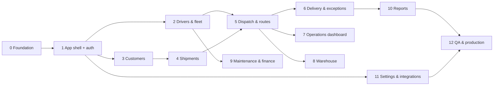

# fleetflow-admin: Development Phases

Statuses: `NOT STARTED` · `IN PROGRESS` · `BLOCKED` · `COMPLETED` (only after verified acceptance and owner checkpoint). Keep in sync with [memory.md](memory.md).

**Current phase: Phase 3 (Customers), IN PROGRESS** (PRs 1 and 2 merged as #5 and #6; PR 3 addresses implemented on `feature/admin-customer-addresses`, not yet merged). Phase 0 COMPLETED 2026-11-23. Phase 1 COMPLETED 2026-11-24. Phase 2 follows Phase 3 PR 3 (owner order, 2026-11-25), then Phase 4.

## Ordering and dependencies
The PROJECT.md order is kept with two adjustments:
- **Customers (4) moves before Shipments (3)**, because shipment creation needs customer and address selection. They are renumbered below as Phase 3 = Customers, Phase 4 = Shipments.
- **Dashboard moves after Shipments and Dispatch** (Phase 7). A dashboard built before there is real data and real KPI endpoints becomes a mock dashboard, which the project rules forbid.

Each admin phase is gated on the fleetflow-api phase that provides its endpoints. The API phases are in `../fleetflow-api/phases.md`.

---

## Phase 0: Architecture & UI Foundation
- **Status**: COMPLETED (2026-11-23). PR #1 merged; owner checkpoint passed.
- **Deferred from this phase**: MSW and openapi-fetch move to Phase 1, where the first API call is made. Sentry, hosting and the map tile provider still need owner decisions.
- **Goal**: an approved stack, design tokens and an empty, tooled Next.js app.
- **Deliverables**: owner decisions (API typing tool, TypeScript version, map tile provider, Sentry, hosting); `create-next-app` with the TS strict config; Tailwind v4 plus `tokens.css` implementing design.md (light and dark); shadcn/ui init with the base primitives restyled; IBM Plex fonts; ESLint, Prettier and typecheck; Vitest plus RTL plus MSW; Playwright plus axe; CI; `.env.example`; `npm run api:types` script against the fleetflow-api schema.
- **Dependencies**: owner approval of docs; fleetflow-api Phase 0 (schema endpoint).
- **Acceptance**: `npm run build`, `lint`, `typecheck` and `test` all green in CI; a token showcase route (dev-only) renders every token and base component in both themes with axe clean.
- **Required tests**: one component test, one Playwright smoke test with axe.
- **Out of scope**: real pages, auth, API calls.
- **Checkpoint**: owner reviews the token showcase (visual sign-off of design.md).

## Phase 1: Core Application Shell
- **Status**: COMPLETED (2026-11-24). PRs #2 and #3 merged; owner checkpoint passed. Delivered in three PRs:
  1. `feature/admin-auth`: BFF auth routes and cookies, `proxy.ts` redirect and refresh, auth pages, `(console)` session gate. Merged (PR #2).
  2. `feature/admin-shell`: design system v2 (D-ADM-15), shell, navigation, session context and `usePermissions`, branch switcher, theme preference, 404 and error boundary. Merged (PR #2).
  3. `feature/admin-users`: `/bff/api/v1` proxy, typed client, TanStack Query, DataTable, Empty/Error/Forbidden states, cursor pagination, `RequirePermission`, Settings → Users list and detail (read-only, `users.view`; D-ADM-11), reusable `Select` (page-size control). Merged (PR #3).
- **Deferred to the first module that needs them**: toasts, client-side `PermissionGate`, `ConfirmDialog`, idempotency keys and field-error mapping (delivered in Phase 3 PR 2 with the first mutations); the shared `SearchInput` (delivered in Phase 3 PR 1); FilterBar (still deferred).
- **Checkpoint**: owner visual sign-off of design v2.
- **Scope**: `(auth)` pages (login, forgot and reset password); BFF auth routes and the `/bff/[...path]` proxy with refresh; `proxy.ts` redirect; `(console)` shell (sidebar, header, breadcrumbs, branch switcher, theme toggle, user menu); permission model (`usePermissions`, `PermissionGate`, 403 page); shared components: DataTable, FilterBar, PageHeader, StatusBadge, Empty/Error/Loading states, ConfirmDialog, Toasts, FormField; global error boundary; 404.
- **Dependencies**: API Phase 1.
- **Acceptance**: architecture §24.7 Auth & permissions table passes (mocked and full stack); shared components pass the §24.2 table; axe clean.
- **Out of scope**: any business module screens.

## Phase 2: Drivers & Fleet
- **Status**: NOT STARTED (unblocked 2026-11-25 for vehicles, drivers and leave: fleetflow-api Phase 3 PRs 1 and 2 are on `main`; documents wait for API Phase 3 PR 3). Runs after Phase 3 PR 3 and before Phase 4.
- **Scope**: drivers list and detail, driver documents with upload and expiry, vehicles list and detail, vehicle documents, availability management (leave, suspension).
- **Dependencies**: API Phase 3 (PRs 1 and 2 merged; documents need PR 3); admin Phase 1. API requests to raise first: `GET /branches/` and the users `?role=` filter (memory.md).
- **Suggested delivery**: (1) vehicles list and detail, read-only; (2) vehicle create, edit, status and archive; (3) drivers list and detail with availability and leave; (4) driver create, edit, status, archive and leave changes; (5) documents with uploads, after API Phase 3 PR 3.
- **Tests**: §24.3 forms, §24.4 tables, §24.8 upload rows applicable to documents.

## Phase 3: Customers
- **Status**: IN PROGRESS (plan approved 2026-11-24; PRs 1 and 2 merged #5 and #6; PR 3 implemented 2026-11-25, not committed)
- **Scope**: customer list and detail, business accounts, addresses with optional latitude/longitude fields. Map pin confirmation moves to Phase 5 (D-ADM-23).
- **Dependencies**: API Phase 2 (COMPLETED 2026-11-24).
- **Delivery (3 PRs)**:
  1. `feature/admin-customers`: read-only list (search, archived toggle, cursor paging) and detail with addresses; shared `SearchInput`.
  2. `feature/admin-customers-manage`: create (`/customers/new`) and edit (`/customers/[id]/edit`) as pages sharing one form, and archive with a confirmation. First mutations, so toasts, `PermissionGate`, `ConfirmDialog`, the dirty-form guard and idempotency keys land here.
  3. `feature/admin-customer-addresses`: address create, edit (as pages, owner 2026-11-25) and archive.

## Phase 4: Shipment Management
- **Status**: NOT STARTED
- **Scope**: shipment list (filters, search, saved views via URL), create and edit draft form, shipment detail with tracking timeline, status actions (allowed transitions only, from the API), cancel with confirmation, public tracking page `track/[token]`, bulk import UI (once API Phase 6 import is available; until then, hidden).
- **Dependencies**: API Phase 2 (COMPLETED); admin Phase 3.
- **Delivery (5 PRs)**: (1) list with URL filters and `StatusBadge`; (2) detail with timeline and tracking token; (3) create and edit draft form (needs the API `service-types` endpoint); (4) status actions with `expected_status`; (5) public `track/[token]` page.
- **Tests**: §24.3, §24.4, §24.8 (import), E2E step 1 and step 7.

## Phase 5: Dispatch & Routes
- **Status**: NOT STARTED
- **Scope**: dispatch board (unassigned list, routes, map panel), route builder (add, reorder, remove stops), driver and vehicle assignment with conflict display, dispatch action, manifests view, routes list and detail.
- **Dependencies**: API Phase 4 (realtime additions after API Phase 7); admin Phases 2 and 4.
- **Tests**: §24.5 dispatch board table (realtime rows once API Phase 7 is done), E2E steps 2 and 4.

## Phase 6: Delivery & Exceptions
- **Status**: NOT STARTED
- **Scope**: exceptions queue with SLA age, resolution actions (retry, reassign, return, cancel), POD review (preview, lightbox, location-match flag), delivery attempts history, returns.
- **Dependencies**: API Phase 5.
- **Tests**: E2E steps 8–9 plus the failed-delivery flow.

## Phase 7: Operations Dashboard & Live Tracking
- **Status**: NOT STARTED
- **Scope**: KPI strip, status mix, active routes, open exceptions, alerts; live fleet map with freshness; realtime connection plus polling fallback across the board and dashboard.
- **Dependencies**: API Phase 7 (realtime, location); API Phase 10 for full KPIs (interim: counts from list endpoints only, clearly labelled).
- **Tests**: §24.6 maps table, E2E steps 5–6 and 10 (partial until reports exist).

## Phase 8: Warehouse
- **Status**: NOT STARTED
- **Scope**: receiving, sorting and staging, loading verification against the manifest, scan input (USB/Bluetooth keyboard-wedge scanners plus manual entry), misroute alerts.
- **Dependencies**: API Phase 6.
- **Tests**: E2E step 3; duplicate, unknown and wrong-route scan feedback.

## Phase 9: Maintenance & Finance
- **Status**: NOT STARTED
- **Scope**: maintenance records and schedule, fuel and expenses, anomaly flags, vehicle cost views. Invoices and COD reconciliation are FUTURE (they depend on the API billing module).
- **Dependencies**: API Phase 8.

## Phase 10: Reports
- **Status**: NOT STARTED
- **Scope**: shipment, driver and fleet reports; cost analytics; async export flow.
- **Dependencies**: API Phase 10.

## Phase 11: Settings & Integrations
- **Status**: NOT STARTED
- **Scope**: users, roles and permissions (view and assign), company settings, warehouses, delivery zones (polygon editor), service types and POD policies, notification templates, integrations and API keys, audit log viewer.
- **Dependencies**: matching API endpoints (Phases 1, 6, 9). Basic user management may be pulled earlier if needed for onboarding (NEEDS APPROVAL).

## Phase 12: QA & Production Readiness
- **Status**: NOT STARTED
- **Scope**: cross-browser (Chromium, Firefox, WebKit), WCAG 2.2 AA audit, responsive checks (768/1024/1280/1920), performance budgets (§21), security headers and CSP, full-stack E2E suite green, visual regression decision.
- **Acceptance**: zero serious or critical axe issues; budgets met; all §24.9 E2E scenarios passing against staging.
